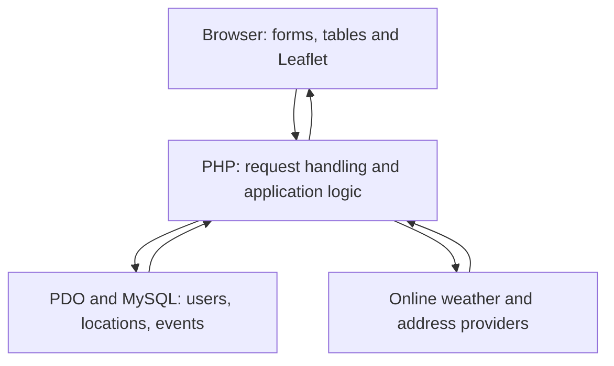
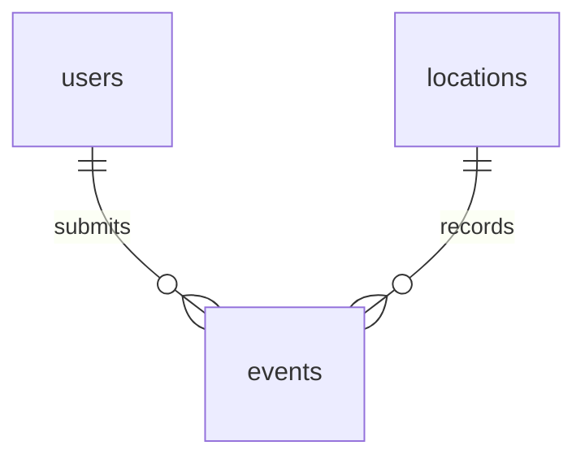

# SmartSlope — Version 1.0

SmartSlope is an academic landslide-awareness web application for Barangay
Irisan, Baguio City. It combines an offline map, API weather records, simple
rainfall screening, and resident observations. It is not an official warning
service or a validated landslide prediction system.

## Features

- Registration and username/password login; separate resident/admin dashboards.
- Offline Leaflet map, Irisan boundary, active locations, and saved risk colors.
- Click-to-select weather refresh, saved readings, timestamps, and freshness checks.
- Automatic approximate addresses when online; saved addresses work offline.
- Resident reports with selected address/coordinates, required phone and email.
- Admin report review, original report-point map, and pending/reviewed/resolved filters.
- Admin location management and reading edits, risk overrides, and deletion.
- Reading CSV download for both roles; admin reading/location import and location export.
- Admin row selection and bulk actions. Linked locations are deactivated rather
  than deleted; only unlinked locations can be permanently deleted.

## Technology and structure

PHP 8+, PDO/MySQL, small PHP classes and functions, Bootstrap 5, local Leaflet,
and plain JavaScript Fetch for asynchronous JSON requests. No framework,
Composer, Node build, URL rewriting, or environment-file loader is required.
Node is optional for JavaScript syntax checks, not for running the website.

| Location | Responsibility |
| --- | --- |
| `config.php` | Database settings and browser `BASE_URL` |
| `class/` | PDO connection, users, locations, events, reports, readings, risk, CSV and bulk SQL |
| `includes/` | Session start, reusable views, boundary/address/weather functions |
| `users/admin/` | Admin pages and actions |
| `users/user/` | Resident dashboard and report form |
| `api/` | Authenticated saved-reading/weather and address endpoints |
| `assets/` | Local styles, JavaScript, Leaflet, boundary and PNG tiles |
| `database/schema.sql` | Three-table installation schema |

PHP includes use `__DIR__`; browser links use `BASE_URL`. These serve different
purposes: a filesystem path cannot be used as a browser URL.

## Install locally

1. Use PHP 8.0+ with `pdo_mysql`, `curl`, JSON and sessions, and MySQL/MariaDB.
2. Put the repository in the web server's document folder. For XAMPP, use
   `htdocs/project1`; start Apache and MySQL. For Herd, serve/link the repository
   as `project1.test` and start a separate MySQL server (Herd alone is not MySQL).
3. For a **new database only**, import `database/schema.sql` in phpMyAdmin or
   your MySQL client. It creates `smartslope_mvp`, the three tables, an admin and
   an Irisan pilot point. Existing installations do not need a schema import.
4. Edit the five database constants in `config.php` to match your server. The
   checked-in port/password may not match yours. Typical XAMPP defaults are
   port `3306`, user `root`, empty password; verify your actual installation.
   Herd's database port/user/password come from your separately installed server.
5. Set `BASE_URL = '/project1'` for `http://localhost/project1`, or `BASE_URL = ''`
   for `http://project1.test`. Use no trailing slash. A custom port belongs in
   the address bar, not in `BASE_URL`.
6. Open `index.php` through that URL. On a fresh installation, the seed login is
   `admin` / `admin123`. This is a demonstration credential: change its hash in
   the database before sharing the installation. There is no password-change UI.
   Generate a replacement with `password_hash()`; do not store plaintext.
7. Register a resident account, then follow [the test guide](#test-guide).

The offline tile set is already included: 110 PNGs under zoom directories
12–15. Keep the `zoom/x/y.png` names. Zoom 16 enlarges zoom 15 images. Do not
open PHP files directly in Finder: PHP and MySQL must be running even offline.


## Architecture

SmartSlope uses a monolithic PHP web application with three logical layers.
The layers describe responsibilities, not the number of physical computers.

| Logical layer | Responsibility | Project examples |
| --- | --- | --- |
| Presentation | Forms, tables, navigation, maps and browser interaction | PHP page markup, includes, Bootstrap, Leaflet, JavaScript |
| Application logic | Authentication, permissions, validation, weather processing, rainfall assessment and report workflows | Page handlers, API handlers, functions and RiskAnalyzer |
| Data access and storage | Prepared SQL, record retrieval and persistence | PDO classes and the MySQL users, locations and events tables |

This is a simple layered design, not strict MVC. Some PHP pages combine request
handling and HTML, and some classes combine data operations with related rules.
That is intentional for the project's academic scope.

The browser communicates with PHP over HTTP. PHP communicates with MySQL
through PDO. The browser never connects directly to MySQL. PHP also contacts
the weather and address providers when those features are used.



On Herd or XAMPP, these components can run on the same computer. Calling this
three logical layers does not mean that three servers have been deployed.

## Website workflow

### Registration and login

1. The visitor opens the login/registration page.
2. Registration checks the submitted account details.
3. PHP hashes the password and creates a resident account using PDO.
4. Login retrieves the account and verifies the password.
5. PHP stores the account identity and role in the session.
6. The resident or administrator dashboard opens according to that role.

### Map, weather and assessment

1. A logged-in user opens the dashboard.
2. PHP loads active locations and saved readings.
3. Leaflet displays the local tiles, Irisan boundary and saved markers.
4. The user selects a location or clicks inside the boundary.
5. The address lookup attempts to resolve the selected coordinates.
6. On a dashboard, PHP requests weather data and checks the response.
7. Complete hourly precipitation values produce the rainfall totals.
8. RiskAnalyzer applies the prototype rules.
9. A successful request saves the reading; the page displays saved results.
10. Provider failure preserves previous readings and displays a message.

Opening or reloading a dashboard alone does not save a new weather reading.

### Resident report

1. The resident chooses an active saved location or clicks the report map.
2. The address, latitude and longitude appear in the form.
3. The resident supplies the observation and required contact details.
4. PHP checks the submission and location.
5. The report is saved with a snapshot of its reported point and address.
6. The resident sees the report in their own history.
7. Administrators can review the report and its location map.

### Administrator management

1. The administrator reviews pending reports and saved readings.
2. View opens report details; the report map shows the saved reported point.
3. The administrator changes the review status when appropriate.
4. Reading Edit changes allowed values and the saved risk status.
5. To delete one record, select its checkbox and choose Delete selected.
6. To delete several records, select their checkboxes or Select all.
7. Confirm the action; PHP checks the administrator role and record type.
8. Only the selected eligible records are removed.

Individual reading-row and report-modal Delete buttons are omitted.
Report status controls, View and reading Edit remain available.

### Locations and CSV

1. Administrators select a saved location or choose a new point.
2. They save a name and optional house/location information.
3. Resolved addresses are saved when available.
4. Deactivation hides locations from selection maps while preserving history.
5. Location deletion only removes unlinked locations.
6. Both roles can download reading CSV files.
7. Administrators can also import readings/locations and export locations.
8. Imports check the site's CSV format and report imported/skipped records.

## Verification commands

The submission copy does not include development-only tools.
From the repository root on macOS/Linux, check PHP syntax with:

```bash
find . -name '*.php' -not -path './.git/*' -exec php -l {} \;
```

On Windows PowerShell with XAMPP:

```powershell
Get-ChildItem -Recurse -Filter *.php |
    ForEach-Object { & C:\xampp\php\php.exe -l $_.FullName }
```

If Node is installed, also run:

```bash
node --check assets/js/location-map.js
node --check assets/js/weather.js
node --check assets/js/report-maps.js
node --check assets/js/bulk-select.js
```

Node is not required to run the website. Syntax checks do not replace browser
and database workflow tests. Use the Test guide below and record actual results.

## Documentation contents

- [Application, API and database reference](#application-reference)
- [Test guide](#test-guide)
- [Course alignment and submission checklist](#course-alignment)
- [Six-week team integration plan](SIX_WEEK_PLAN.md)


<a id="application-reference"></a>

## Application reference

### Purpose and scope

Provide a single-area academic interface for viewing weather-based rainfall
screening and collecting resident observations in Barangay Irisan. Resident
reports provide context, not automatic hazard confirmation. Administrators
manage records and review submissions. No measured accuracy, adoption, revenue
or sensor deployment is claimed.

### Roles and data flow

| Action | Resident | Admin |
| --- | --- | --- |
| Map, saved readings/details, weather refresh | Yes | Yes |
| Reading CSV download | Yes | Yes |
| Submit report, see own history | Yes | No resident form |
| See all reports/contact details; review/delete | No | Yes |
| Location create/edit/activate/deactivate | No | Yes |
| Edit saved reading values/risk, delete readings | No | Yes |
| Reading/location CSV import, location export | No | Yes |
| Bulk data actions | No | Yes |

A map selection performs address lookup, then (on dashboards) posts a weather
request. PHP validates coordinates and provider data, calculates rainfall totals,
saves the event and returns JSON. The browser reloads saved data. Normal page
loads do not fetch/save weather. Failed providers preserve existing readings.

The report form selects an active location or creates one for valid new
coordinates on successful submission. A report event stores the point/address
snapshot in `provider_payload`. Reports do not affect calculated rainfall risk.

### Routes

| File | Purpose |
| --- | --- |
| `index.php` | Register/login; server assigns new registrations role user |
| `dashboard.php` | Redirect to role-specific dashboard |
| `users/admin/admin.php`, `users/user/user.php` | Role-specific dashboard entry points |
| `users/admin/admin_panel.php` | Location management |
| `users/user/submit_report.php` | Resident report form and own history |
| `users/admin/reports.php` | Report filters, View map, review and deletion |
| `readings.php` | Saved history, detail panel, admin deletion and CSV controls |
| `users/admin/edit_reading.php` | Admin values and saved-risk editing |
| `users/admin/bulk.php` | Admin POST-only selected-row actions |
| `csv.php?kind=readings` or `kind=locations` | GET download / admin POST multipart `csv_file` import |
| `methodology.php` | Rainfall rules, data sources and limitations |
| `logout.php` | POST logout |

### JSON endpoints

`api/readings.php`: authentication required. GET `location_id` loads saved data;
POST `location_id` or `lat` + `lng` refreshes weather. Successful JSON contains
`location_id`, `saved_id` (null for GET), `reading`, and `assessment`. Assessment
contains status, category, expires_at, calculated_category and adjusted.
Errors use `error`: 400 invalid/inactive point, 401 unauthenticated, 405 method,
502 provider/runtime failure, 503 database failure or 500 unexpected processing.

`api/address.php`: authenticated GET `lat` + `lng`; returns `name` and `address`
when available. A failed detailed lookup can return HTTP 200 with empty address
and an explanatory error. This is a usable coordinate selection, not a crash.
Addresses are cached in the session (maximum 100 entries) and uncached lookups
are limited to one per second per session. It is not a global provider throttle.

### Rainfall screening

| Category | 1h threshold | 24h threshold | 72h threshold |
| --- | --- | --- | --- |
| High | 50 mm | 100 mm | 150 mm |
| Medium | 25 mm | 50 mm | 100 mm |
| Normal | 10 mm | 25 mm | 50 mm |
| Low | Below every threshold | Below every threshold | Below every threshold |

Highest qualifying category wins if any window reaches its threshold. Values
must be finite, nonnegative and ordered 1h ≤ 24h ≤ 72h. These are prototype
software rules, not published/calibrated Irisan alert thresholds. The rule ID is
`prototype-1`; this does not indicate a prior application release.

Hourly precipitation comes from Open-Meteo. Only completed hourly samples are
summed, ending at the observation hour in UTC. Complete 72-hour history is
required. Current assessment needs compatible metadata and a window younger
than three hours; missing/legacy/imported metadata is incomplete, not fresh.
Admin-selected risk is kept distinct from calculated rainfall category.
Map colors represent the latest unarchived **saved** reading, which can be old.

### Database relationships

Exactly three tables: `users`, `locations`, `events`. One user can have many
report events; one location can have many reading/report events. `type` separates
reading and report rows. Most type-specific columns are nullable because they
share one events table. This keeps the schema small but requires every action
to constrain event type. It is not a separate sensor or alerts database.



`events.user_id` is optional and deletes set it NULL. Deleting a location at the
SQL level cascades to its events; application bulk delete prevents deleting
linked locations. Deactivation changes visibility without deleting history.
`reviewed_by` is an ID value but the schema does not declare a foreign key for it.

The following dictionary reflects database/schema.sql. Fields retained in the
schema but unused by the UI are identified; do not remove them during setup.

#### users

| Field | SQL definition | Meaning |
| --- | --- | --- |
| `id` | `INT UNSIGNED NOT NULL AUTO_INCREMENT` | Auto-increment primary key. |
| `full_name` | `VARCHAR(100) NOT NULL` | Account display name. |
| `username` | `VARCHAR(50) NOT NULL` | Unique login name. |
| `email` | `VARCHAR(254) NOT NULL` | Unique account email. |
| `phone` | `VARCHAR(20) NOT NULL` | Unique account contact number. |
| `password` | `VARCHAR(255) NOT NULL` | Hash generated by password_hash(); never plaintext. |
| `role` | `ENUM('admin', 'user') NOT NULL DEFAULT 'user'` | admin or user; registration assigns user. |
| `created_at` | `TIMESTAMP NOT NULL DEFAULT CURRENT_TIMESTAMP` | Creation timestamp; connections use UTC. |

#### locations

| Field | SQL definition | Meaning |
| --- | --- | --- |
| `id` | `INT UNSIGNED NOT NULL AUTO_INCREMENT` | Auto-increment primary key. |
| `name` | `VARCHAR(150) NOT NULL` | Saved location name. |
| `purok` | `VARCHAR(100)` | Optional house number / extra location information (UI label). |
| `landmark` | `VARCHAR(255)` | Saved mapped address / landmark. |
| `lat` | `DECIMAL(9,6)` | Latitude; application restricts selected points to Irisan. |
| `lng` | `DECIMAL(9,6)` | Longitude; unique pair with latitude. |
| `susceptibility` | `ENUM('very_high','high','moderate','low','debris_flow','unknown') DEFAULT 'unknown'` | Stored metadata; not used in Version 1.0 rainfall calculation. |
| `active` | `TINYINT(1) DEFAULT 1` | 1 active; 0 hidden from selection maps/dropdowns. |
| `created_at` | `TIMESTAMP NOT NULL DEFAULT CURRENT_TIMESTAMP` | Creation timestamp; connections use UTC. |

#### events

| Field | SQL definition | Meaning |
| --- | --- | --- |
| `id` | `INT UNSIGNED NOT NULL AUTO_INCREMENT` | Auto-increment primary key. |
| `location_id` | `INT UNSIGNED NOT NULL` | Required FK to locations.id; SQL ON DELETE CASCADE. |
| `user_id` | `INT UNSIGNED` | Optional FK to users.id; ON DELETE SET NULL. |
| `type` | `ENUM('reading','report') NOT NULL` | reading or report; actions must constrain this field. |
| `rainfall_1h` | `DECIMAL(7,2)` | Precipitation total in mm over one completed hour. |
| `rainfall_24h` | `DECIMAL(7,2)` | Precipitation total in mm over 24 completed hours. |
| `rainfall_72h` | `DECIMAL(7,2)` | Precipitation total in mm over 72 completed hours. |
| `rainfall_forecast_24h` | `DECIMAL(7,2)` | Reserved; not used by this release. |
| `precipitation_probability_24h` | `TINYINT UNSIGNED` | Reserved; not used by this release. |
| `soil_moisture_9_27cm` | `DECIMAL(6,4)` | Reserved; not used by this release. |
| `soil_moisture_27_81cm` | `DECIMAL(6,4)` | Reserved; not used by this release. |
| `risk_level` | `ENUM('low','normal','medium','high') DEFAULT 'low'` | Saved low/normal/medium/high category; may be admin-selected. |
| `temperature` | `DECIMAL(5,2)` | Temperature in degrees Celsius. |
| `humidity` | `DECIMAL(5,2)` | Relative humidity in percent. |
| `wind_speed` | `DECIMAL(6,2)` | Wind speed in km/h. |
| `weather_code` | `INT` | Provider WMO weather code. |
| `observed_at` | `DATETIME` | Weather observation timestamp, UTC. |
| `source` | `ENUM('openmeteo','manual') DEFAULT 'openmeteo'` | openmeteo or manual (including CSV). |
| `message` | `TEXT` | Resident observation text. |
| `contact_phone` | `VARCHAR(20)` | Required by report form. |
| `contact_email` | `VARCHAR(254)` | Required by report form. |
| `house_landmark` | `VARCHAR(255)` | Optional report-specific directions. |
| `status` | `ENUM('pending','reviewed','resolved') DEFAULT 'pending'` | Report workflow: pending/reviewed/resolved. |
| `rule_version` | `VARCHAR(40) NULL` | Rainfall rule identifier; nullable for legacy/CSV records. |
| `rainfall_window_end` | `DATETIME NULL` | Completed-hour end time, UTC. |
| `provider_payload` | `LONGTEXT NULL` | Reading: provider JSON; report: report_location point/address snapshot. |
| `adjustment_log` | `LONGTEXT NULL` | Admin edit/import metadata JSON. |
| `report_type` | `VARCHAR(30) NULL` | cracks/landslide/drainage/other, validated in PHP. |
| `occurred_at` | `DATETIME NULL` | Report observation time stored UTC; form uses Manila time. |
| `reviewed_by` | `INT UNSIGNED NULL` | Reviewing admin ID; no declared FK. |
| `reviewed_at` | `DATETIME NULL` | Review timestamp, UTC. |
| `created_at` | `TIMESTAMP NOT NULL DEFAULT CURRENT_TIMESTAMP` | Creation timestamp; connections use UTC. |
| `archived` | `TINYINT(1) DEFAULT 0` | Reading list excludes 1; no archive UI. |
| `stale` | `TINYINT(1) DEFAULT 0` | Retained legacy flag; assessment freshness is computed from timestamps. |

#### Keys and constraints

users: unique username/email/phone. locations: unique latitude/longitude pair.
events: indexes on location_id, user_id, type, risk_level and archived, plus primary
key. Imported duplicates use location and observed_at checks in application code;
there is no database unique constraint on that event pair. Concurrent imports
are not guaranteed duplicate-free. Admin bulk actions accept up to 500 IDs.

### External dependencies and operations

Open-Meteo weather endpoint and Photon reverse lookup require internet and PHP
cURL. Providers may fail, limit requests or change. Errors are surfaced without
replacing saved weather. Address accuracy depends on mapped coverage. Local
Bootstrap and Leaflet are served without CDNs. Preserve bundled licenses and
OpenStreetMap attribution; tile image redistribution provenance needs confirmation
before public hosting. The repository's tile README records that limitation.

Use database exports for backups, not CSV alone. No password-reset/change UI,
email/SMS delivery, scheduled weather polling, realtime cross-tab push updates,
payments, sensor ingestion, location susceptibility calibration or production
monitoring is implemented. Sessions do not regenerate IDs and no CSRF token
scheme/login throttling is provided; public deployment requires hardening.

<a id="test-guide"></a>

## Test guide

### 1. Prepare the test installation

1. Use a disposable database or back up your current database. Bulk deletion is
   permanent. CSV is not a full database backup.
2. Follow the README setup. Start PHP/web server and MySQL. Confirm `BASE_URL`
   and database credentials. Do not re-import schema.sql into your working data.
3. Use two browser profiles or a regular/private window: one admin and one
   resident. Create a second resident for privacy checks. Use fictional contact
   details and clearly label test observations. Do not submit real emergency reports.
4. Record the date, browser, PHP version (`php -v`), database version, commit
   (`git rev-parse HEAD`) and URL in the result record below.
5. Run the PHP syntax checks listed in this README. Investigate every syntax
   error. Check database connectivity by logging in and loading saved records.
6. If Node is installed, check the app JavaScript:

```bash
node --check assets/js/location-map.js
node --check assets/js/weather.js
node --check assets/js/report-maps.js
node --check assets/js/bulk-select.js
```

7. Open the browser Developer Tools Console and Network tabs. Clear old output.
   Keep them open while testing. Note the HTTP response when an action fails;
   distinguish an expected validation/provider error from a PHP crash.

### 2. Authentication and permissions

| Test | Steps | Expected result |
| --- | --- | --- |
| A1 | Register a new resident with all fields. Log in. | Success message; user dashboard; role is user in DB even if a request supplies `role=admin`. |
| A2 | Repeat a username/email/phone, try malformed email, short password or blank fields. | Helpful message; no duplicate account or raw SQL/stack trace. |
| A3 | Try a wrong password, then the correct one. | Wrong password rejected; correct login succeeds. |
| A4 | Log in as admin in the other window. | Admin dashboard and Management links appear. |
| A5 | As resident, open `/users/admin/admin_panel.php`, `/users/admin/reports.php`, `/users/admin/edit_reading.php?id=1`. | Access denied, HTTP 403. Hiding buttons alone is not the check. |
| A6 | Log out, then reload a protected dashboard. Open `/api/readings.php?location_id=1` logged out. | Dashboard redirects to login; API returns 401. Logout requires POST. |
| A7 | Inspect a newly registered user's password column. | A password hash, never the typed plaintext. Do not screenshot passwords/hashes in public evidence. |

### 3. Maps, addresses and weather

1. Open both dashboards. Check the brown Irisan boundary, local tiles, zoom,
   active markers, legend and layout. Inspect Network: tiles should be local
   `assets/map-tiles/...png`, not an online tile CDN.
2. Click a point clearly inside Irisan. The selected coordinates should match
   the point, and a mapped address should appear when the provider has data.
   Nearby addresses can be approximate; no house number is guaranteed.
3. With internet, let weather finish. A successful request saves a reading and
   reloads the selected location. Verify rainfall, UTC time, source and assessment.
4. Press Refresh once. Verify one additional reading after a successful request.
   Reload the page without clicking: it must not save another reading.
5. Use View saved readings here. Confirm the selected location's history, then
   View all to see the full list. Details should show that reading's weather/source.
6. Click outside the boundary. Confirm rejection and no new database reading.
7. Click point A then B rapidly during address lookup. B must remain selected
   even if A's address response arrives later. No A address should overwrite B.
8. Disconnect internet while leaving PHP/MySQL running. Reload the page and
   open saved history: local tiles and saved data remain visible. Refresh should
   report provider failure without deleting old data. A new unmapped address
   may be unavailable; coordinates still identify the selected point.
9. Reconnect. Repeat a successful refresh. Do not treat a timeout as proof that
   no write occurred: reload saved history before retrying.
10. On an admin-edited latest reading, choose low, normal, medium and high in
    turn. Reload the map after each save: green, blue, amber and red respectively.
    The saved category must match; the calculated category is displayed separately
    when an assessment is available. Editing an older row does not override a newer row.
11. Check the documented rainfall thresholds and freshness behavior. Also inspect
    an old reading in the browser: history can retain its colored saved category,
    but the current assessment must say outdated/incomplete rather than fresh.

### 4. Location management

1. In Management choose an active saved location. Verify name, optional house
   information, coordinates and selected address.
2. Click a new point inside the map. This starts an Add location form. Save it
   with a unique test name and optional house information. There is no editable
   full-address input; a resolved address is saved automatically when available.
3. Select the saved row again and edit its name/house information. Confirm the
   existing ID is updated rather than a duplicate inserted.
4. Try blank name, outside coordinates and an existing coordinate pair. Confirm
   validation/duplicate feedback; no fatal error or unintended overwrite.
5. Deactivate the test location. Reload both dashboards, Management's map and
   the resident report picker: it must disappear from active maps/dropdowns,
   but remain in the management table and historical reports/readings.
6. Reactivate it. Confirm it returns. Select two test locations and bulk
   deactivate/reactivate. Check Select all applies only to displayed rows.
7. Select an unlinked test location and a location with a reading/report. Choose
   bulk Delete: the unlinked one disappears; the linked one is skipped. Its
   events remain. Deactivate the linked location if it should be hidden.

### 5. Resident reports and admin review

1. As resident A, choose a saved location in Submit report. Visible read-only
   latitude, longitude and address fields must fill automatically.
2. Click another map point. Fields and selection must switch to that point.
   Select a saved option again: the marker and fields must agree with that option.
3. Leave phone/email blank or enter invalid email. Submission must fail without
   creating a report. The chosen point and written message should remain.
4. Submit valid required details, observation type and Manila observation time.
   Verify a success message and a new entry in Your reports. The stored/displayed
   observation time is UTC (Manila time minus eight hours).
5. Log in as resident B. A's private report history/contact details must not
   appear. Shared weather/location records remain visible by design.
6. As admin, open Pending reports and View the submitted report. Check contact,
   description and the map at the original submitted coordinates. Close/reopen
   the modal; the map must stay correctly sized. Repeat on a narrow viewport.
7. Edit/move/deactivate the linked location. Reopen the report. New reports retain
   their submission point/address; older reports lacking a snapshot use the linked
   location and are labeled accordingly.
8. Change Pending to Reviewed to Resolved. Check each filter and dashboard count.
   Review status does not change rainfall risk or certify safety.
9. Select one test report using its checkbox and Delete selected, then repeat
   with two different test reports. Verify only those reports disappear. Test empty selection:
   it must show a message and delete nothing.

### 6. Reading management and CSV

1. Edit a test reading as admin. Change rainfall/weather within valid ranges and
   choose a saved risk. Save and reopen. Verify stored values, manual source and
   preserved observation time. Invalid values must not be saved.
2. Select one test reading and Delete selected, then repeat with two checkboxes. Verify only selected
   reading IDs disappear. Report records must remain.
3. As resident, download the readings CSV. As admin, download readings and
   locations. Headers and rows must appear without HTML, warnings or login pages.
4. Import each unchanged download as admin. Existing records should be skipped,
   not duplicated, renamed or reactivated. Residents must have no import controls;
   a direct resident POST to `csv.php` must return 403.
5. To test new location import, copy a locations CSV, retain its exact header and
   format marker, and add a row with a unique coordinate inside Irisan and a test
   name. Import it. Verify the location appears. Use straight CSV quotes; do not
   change the header names or sheet-save it as XLSX.
6. For a new reading, copy a readings CSV row and use a different valid UTC
   `observed_at_utc`, e.g. `2025-01-02 03:04:05` if unused at that location.
   Import. Verify its weather values and saved risk, source manual, and historical
   rather than fresh assessment. Repeat: duplicate is skipped.
7. Try a wrong header, invalid risk, outside coordinates and a valid row followed
   by an invalid row. The whole file must be rejected with no partial import.
   Try an empty/header-only file and a non-CSV file: clear error, no database changes.
8. Confirm quoted commas and Unicode location names survive export/import. Text
   cells have a leading apostrophe for spreadsheet handling; import removes that
   prefix. Export/import is not a full backup of provider payloads/edit history.
9. Limits: upload at most 2 MB and 2000 data rows; select at most 500 bulk rows.
   Larger downloads must be split into valid files before import. Readings match
   by location coordinates plus UTC observation time, including archived rows.
   Inactive locations' reading imports are skipped. Invalid files are rejected.

### 7. Layout, deployment and error checks

- Test desktop and a roughly 375px-wide viewport. Check navigation, readable
  form labels, horizontal table scrolling, dialogs, map controls and buttons.
- Inspect Console for uncaught JavaScript errors and Network for missing CSS,
  JavaScript, GeoJSON and PNG files. Investigate unexpected HTTP 500 responses.
- Test once at Herd root URL and once at XAMPP's `/project1` subfolder. Match
  BASE_URL each time. The CLI PHP version can differ from the web server's PHP.
- In an isolated test installation, stop MySQL and open a DB-dependent page:
  expect the application's safe error, no credentials/SQL stack trace. Restart it.
- Inspect your PHP/web-server logs after tests for warnings/fatals. Do not edit
  production/server configuration to reproduce a failure in your only installation.
- Refresh an open second browser tab after changing risk or active status: maps
  are not pushed live across tabs. Check blank tables after deleting all test rows.

### 8. Result record and submission gate

Make a copy of this table for each local environment. Do not pre-mark PASS.
Attach screenshots with fictional data and relevant log extracts; avoid passwords.

| Item | Actual result / evidence |
| --- | --- |
| Tester, date, commit | Not yet recorded |
| URL, OS, PHP, database, browser | Not yet recorded |
| Syntax check output and database check | Not yet recorded |
| Authentication/permissions A1–A7 | Not yet recorded |
| Maps, addresses, weather/freshness | Not yet recorded |
| Location CRUD and bulk operations | Not yet recorded |
| Reports, privacy, modal map | Not yet recorded |
| Reading edits, CSV, bulk deletion | Not yet recorded |
| Offline and provider failure | Not yet recorded |
| Desktop/mobile and both URL layouts | Not yet recorded |
| Remaining issues and owner | Not yet recorded |
| Final local acceptance | Pending |

The project is ready for a classroom demonstration when these local checks pass
and the remaining course deliverables in this README's Course alignment are prepared. Automated
checks alone do not certify production security or landslide prediction accuracy.

<a id="course-alignment"></a>

## Course alignment

This is an implementation-to-materials mapping, not a teacher's grading decision.
The supplied materials do not establish every final marking criterion. Confirm
submission format, required demonstrations and deadlines with the instructor.

### WEBSYS1

Source: supplied Syllabus.pdf, course learning-plan pages printed 5–7 of 19.

| Topic/outcome | Implementation evidence | Status / action |
| --- | --- | --- |
| PHP basics, forms and functions | Page handlers, boundary/weather/address functions | Implemented; explain control flow in defense |
| PDO/MySQL CRUD | class/db.php, users/locations/reports/readings/CSV classes | Implemented; show create/read/update/delete with test records |
| Classes and objects | Small classes extending db; independent RiskAnalyzer | Implemented; show object creation and prepared SQL |
| AJAX and API/JSON integration | assets/js/weather.js and location-map.js; api/readings.php and api/address.php | Implemented with Fetch |
| jQuery | No application use of jQuery; Bootstrap internals mentioning it are not evidence | Confirm whether instructor requires an explicit jQuery implementation; do not claim this topic is implemented |
| SQL injection and password storage | Prepared parameters, password_hash/password_verify | Implemented, subject to testing |
| XSS and input handling | HTML output escaping, textContent, field/coordinate checks | Implemented in application flows; not a formal penetration test |
| Secure coding practices | Role guards, safe error messages, POST mutation checks | Partial: no CSRF tokens, login session-ID regeneration or login throttling. Do not claim production security |
| Complete dynamic web project | Two roles, saved weather, report review, maps, CSV and bulk management | Local acceptance evidence required; see this README's Test guide |

The syllabus teaches jQuery and security best practices. Fetch-based AJAX is not
jQuery, and basic sessions do not provide all security protections. Resolve any
strict instructor requirement before declaring full course compliance. The
project deliberately keeps its current simple stack; this document does not
silently add a framework or new authentication design.

### IMDBSE2

Source: supplied IMDBSE2 RELATIONAL ALGEBRA PRELIMS.pdf, FINAL PROJECT slide
(PDF page 3). It requests a functional front end and database CRUD application;
progress/contribution, presentation, output and peer evaluation also matter.

| Evidence | Where to demonstrate |
| --- | --- |
| Functional front end and database-backed behavior | Login, both dashboards, location/report/reading pages |
| CRUD | Add/edit/read locations; submit/read/review/delete reports; fetch/import/read/edit/delete readings |
| Relational design | database/schema.sql and this README's Application reference dictionary/relationships |
| Query explanation | JOIN location labels to events; WHERE type/status; ORDER BY observation/id |
| Integrity | FK relations, unique accounts/coordinates, linked-location delete protection |
| Individual contribution and progress | Team's real Git commits and individual explanation; not generated claims |
| Presentation and peer evaluation | Team prepares these separately using the instructor's forms |

There are three tables. The events table combines two record types to keep the
schema small; explain its nullable columns and type-specific SQL. Reserved
weather/soil columns do not mean sensors or forecasts are implemented.

### Startup materials

Source: supplied Startup.pdf (scanned eight-page extract), especially PDF pages
6–7 covering presentation and concept-note content. Treat this as the supplied
reference, not confirmation that its competition eligibility/rules are current.

A working website alone does not complete the startup deliverables. Prepare:

- Startup logo; founder/team introduction with real contributions.
- Problem and beneficiary evidence (interviews/references; no invented demand).
- A deck covering problem, SDG priority, target segment, proposed business model,
  solution/features, use of funds and actual progress/traction.
- A concept note covering summary, problem background, solution, objectives,
  beneficiaries, value proposition, business model, market evidence, operations
  and estimated funding needs.
- Any institution/competition-specific clearance, mentor and submission items
  requested by the instructor. These are not generated by the application.

Proposed business hypothesis for discussion: optional hosted record-management
and support for barangay/community administrators, with resident submission
access. Potential charges would fund hosting, maintenance and training. This is
an unvalidated hypothesis; no prices, customers or revenue are established.
The paid value would be administration/support, not a claim of accurate warning
prediction. Payment collection, subscription management and sales are outside
Version 1.0. Validate willingness to pay, operational ownership and costs first.

### Submission package

- [ ] Source code, bundled dependency licenses, three-table SQL and Version 1.0 docs.
- [ ] Configured local demo; installation instructions tested from a clean setup.
- [ ] Completed this README's Test guide result record for Herd/XAMPP, with fictional data.
- [ ] Screenshots of both dashboards, resident selection, report map, CSV and bulk actions.
- [ ] Database diagram/dictionary and a brief CRUD demonstration.
- [ ] Actual team contribution evidence, presentation and peer-evaluation items.
- [ ] Instructor confirmation about jQuery and security scope.
- [ ] Startup deck/concept note/logo if part of the submitted assessment.
- [ ] Private credentials and personal reports removed from the submitted database export.

Passing code checks supports functional readiness. It does not prove browser
rendering on the student's computer, fulfill missing presentation artifacts,
certify production security, or validate a landslide-warning model.

## Verification status for this packaging change

This documentation consolidation and Delete-button cleanup must be checked
locally after applying the patch. Earlier verification results do not establish
that this exact packaging change has been executed or browser-tested.

The database schema, credentials, rainfall thresholds and bulk-action handlers
are unchanged. Complete the acceptance record above before submission.
