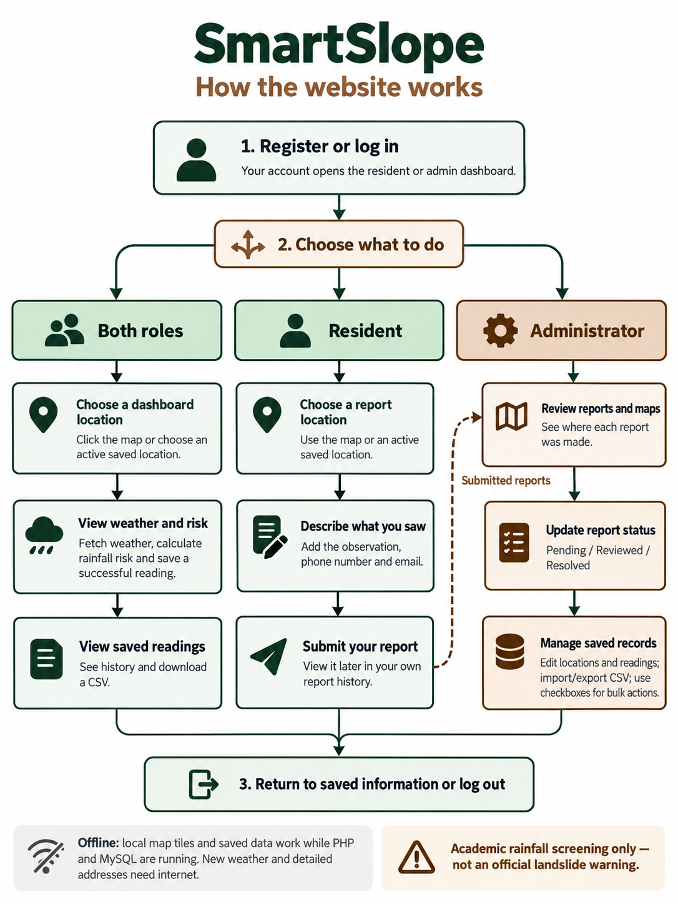

# SmartSlope Version 1.0 — Six-week file-by-file team plan

## Goal and reference

By the end of **Week 2**, registration, login, separate admin/resident dashboards
and the green-and-brown design must work. Later weeks add maps, weather, reports,
CSV and bulk actions. Keep the existing three-table schema unchanged.

Reference: [project1, branch p6](https://github.com/macJil/project1/tree/p6), reviewed
at commit `b79c7fc9b03cbb69da2496d4fcfca0bb4ca51243`. Apply the accompanying
documentation patch to the reference first to obtain this plan and the new image.
Keep that approved reference in a separate folder throughout the six weeks.

This is a copying, adaptation and integration plan. Credit the reference and
record actual contributions and dates. Do not describe copied code as newly
invented work. Replace Member A–D with the team's names.

## Responsibilities

| Member | Main responsibility |
| --- | --- |
| A | Authentication, admin pages, permissions and integration |
| B | Shared layout, dashboard design, tables and controls |
| C | Database, PDO classes, weather/risk logic and CSV |
| D | Maps, resident reporting, browser tests and documentation |

Only the assigned owner edits a file during that week. Other members review it.
Ownership can transfer in later weeks after the previous work has merged.

## How to use the exact file lists

- **Copy new:** copy the file from the approved reference into the identical
  relative path in the official repository, then apply the week's staging notes.
- **Update existing:** edit the official copy in place; compare against the
  reference without overwriting teammates' changes or local configuration.
- **Create:** write the small temporary page described at the named path.
- **Test only:** no new source files to copy; record results in the weekly issue.
- Paths start at the repository root. Preserve filename case, especially
  `class/RiskAnalyzer.php`.

**The final reference files depend on later features.** Copying every assigned
page unchanged in an early week can cause missing includes or broken links.
The staging notes below are part of the assignment. Do not use empty classes,
fake readings or suppressed errors to hide a missing dependency.

## Before Week 1

1. Create the official repository and invite all four members. Keep the approved
   reference separate; never copy its `.git` directory.
2. Agree on the served folder and `BASE_URL`: `/project1` for a XAMPP subfolder,
   or an empty string for a Herd site served at its root. Substitute the actual
   folder name when different. Keep PHP includes anchored with `__DIR__`.
3. Start PHP and MySQL. Herd needs a separate running database server.
4. Create a development database; import `database/schema.sql` only for a new
   database. Keep the `users`, `locations` and `events` tables unchanged.
5. Use fictional accounts/reports and private local database credentials.
6. Create six milestone issues for actual test evidence and contribution notes.

## Week 1 — Foundation and working login

### Member A — Authentication

**Copy new:**

```text
config.php
includes/session.php
index.php
logout.php
```

Set database constants and `BASE_URL`. Keep existing password hashing, prepared
statements and account/role checks. Coordinate with D so login has a working
destination. B reviews the login design; A owns `index.php` this week.

### Member B — Shared design

**Copy new:**

```text
assets/css/bootstrap.min.css
assets/css/bootstrap.min.css.map
assets/css/style.css
assets/js/bootstrap.bundle.min.js
assets/js/bootstrap.bundle.min.js.map
includes/header.php
includes/footer.php
```

Keep vendor license comments. The `.map` files are browser source maps, not map
tiles. In the header show only Dashboard and Log out. Defer Leaflet,
`location-map.js`, `bulk-select.js` and links to Readings, Management, Submit
report and Methodology until those files are introduced.

### Member C — Database and accounts

**Copy new:**

```text
database/schema.sql
class/db.php
class/users.php
```

Import the unchanged schema into the new development database. Test registration,
password verification, duplicate usernames and incorrect passwords.

### Member D — Working role destinations

**Copy new:**

```text
dashboard.php
users/admin/admin.php
users/user/user.php
```

**Create:**

```text
includes/dashboard.php
```

Keep the copied entry pages' authentication/role checks. Create a small shared
landing view using the header/footer, correct role heading and welcome message.
Do not require events, locations, weather or risk classes yet. B replaces this
landing view with the saved-data dashboard in Week 2.

Test login/logout, both role redirects and direct access to the opposite role's
page using `index.php`, `logout.php` and the three copied destination pages.

**Integration order:** C/A establish database/session dependencies; B adds layout;
D adds landing pages; everyone tests the combined build before acceptance.

**Acceptance:** both roles log in/out correctly, protected pages enforce access,
registration creates a resident and stored passwords are hashes. No login
redirect leads to a missing page.

## Week 2 — Dashboards and design ready

### Member A — Routing and permissions

**Review; update existing only if needed:**

```text
dashboard.php
users/admin/admin.php
users/user/user.php
```

Confirm the role entry pages load B's dashboard and retain permission checks.
Leave correct files unchanged. Test both root and subfolder URL layouts.

### Member B — Saved-data dashboards and tables

**Copy new:**

```text
readings.php
includes/readings-table.php
```

**Update existing:**

```text
includes/dashboard.php
includes/header.php
includes/footer.php
assets/css/style.css
```

Use the reference dashboard's headings, cards, tables and role-specific layout.
Stage the files explicitly:

1. Use `class/events.php` for counts, saved readings and reading Details.
2. In the dashboard, defer the location, weather-reading and RiskAnalyzer
   requires and object calls. Do not compute `$assessment` or look up `$latest`
   yet. Display all saved readings without map selection for now.
3. Defer the map/assessment block, weather script, resident report action and
   admin report-review link. Read-only counts/report summaries can remain.
4. In `readings.php`, defer the weather-reading class, POST deletion block and
   CSV tools include. Keep the saved-reading list and detail query.
5. In the reading and dashboard report tables, defer bulk includes, checkbox
   columns and Edit links. Keep Details; adjust column spans to visible columns.
6. Add Readings to the header; keep later links and scripts deferred.

Show honest empty states. Complete responsive cards, tables and navigation now;
later features will use the same visual design.

### Member C — Saved-data queries and dependencies

**Copy new:**

```text
class/events.php
includes/address.php
includes/map-boundary.php
assets/map/irisan.geojson
```

Copy all four together: the event class uses address labels, the address helper
loads the boundary helper, and that helper reads the GeoJSON. Preserve their
behavior. Verify counts against the database and test empty results.

### Member D — Dashboard testing

**Test only; no new files to copy.** Check:

```text
index.php
dashboard.php
users/admin/admin.php
users/user/user.php
readings.php
```

Test both roles, saved-reading Details, mobile navigation, empty states and
Herd/XAMPP paths. Residents must not see the admin report/contact table. Record
screenshots in the weekly issue and send fixes to the appropriate file owner.

**Integration order:** C's dependencies, B's views, A's routing review, D's tests.

**Acceptance:** login, registration, logout, both dashboards, their design and
saved-reading Details work. Map/weather/report features are later milestones;
do not pretend they are complete in Week 2.

## Week 3 — Locations, offline map and addresses

### Member A — Location management

**Copy new:**

```text
users/admin/admin_panel.php
```

Keep create/edit/activate/deactivate controls. Defer CSV and bulk includes,
checkboxes and bulk forms until Week 6. Check direct admin-only access.

### Member B — Map view and dashboard placement

**Copy new:**

```text
includes/location-map.php
```

**Update existing:**

```text
includes/dashboard.php
assets/css/style.css
```

Restore the location class, active locations, selected-location lookup and
filtered saved readings. Set `$showMap` and insert the map view. Keep weather
classes and the assessment panel deferred. Check responsive map placement.

### Member C — Location data

**Copy new:**

```text
class/locations.php
```

Reuse the Week 2 address/boundary dependencies. Test create/edit, active filtering
and coordinate handling. Do not change the schema.

### Member D — Map engine, tiles and address endpoint

**Copy new:**

```text
api/address.php
assets/js/location-map.js
assets/vendor/leaflet/LICENSE
assets/vendor/leaflet/leaflet.css
assets/vendor/leaflet/leaflet.js
assets/vendor/leaflet/images/layers-2x.png
assets/vendor/leaflet/images/layers.png
assets/vendor/leaflet/images/marker-icon-2x.png
assets/vendor/leaflet/images/marker-icon.png
assets/vendor/leaflet/images/marker-shadow.png
assets/map-tiles/README.md
```

Also copy **all 110 PNG tiles** listed in the checklist at the end. The easiest
way is copying the entire `assets/map-tiles/` folder, preserving zoom/x/y names.
The boundary GeoJSON was already copied in Week 2.

**Update existing:**

```text
includes/header.php
```

Enable conditional Leaflet CSS/JS and the location-map script. Add Management
for admins. Keep the bulk script and future links deferred. Stage the map
script for selection, addresses and saved history; do not wire it to unavailable
weather controls/endpoints. Week 4 completes that interaction.

**Integration order:** C's class, B/D's map dependencies, then A's management page.

**Acceptance:** clicks show coordinates and available addresses; inactive places
are hidden from selection maps; local tiles work offline while PHP/MySQL run.
New detailed address lookups still need internet.

## Week 4 — Weather and assessment

### Member A — Weather API

**Copy new:**

```text
api/readings.php
```

Check authentication, GET/POST behavior and provider-failure messages. Opening or
reloading a dashboard alone must not save a new weather reading.

### Member B — Weather display

**Copy new:**

```text
includes/assessment.php
methodology.php
```

**Update existing:**

```text
includes/dashboard.php
includes/header.php
assets/css/style.css
```

Restore weather-reading/RiskAnalyzer requires, latest-reading lookup,
assessment calculation/view and weather script. Add Methodology to navigation.
Match the reference loading, error, source and freshness labels. Keep later
report/bulk controls deferred.

### Member C — Weather processing and risk rules

**Copy new:**

```text
class/RiskAnalyzer.php
class/weather_readings.php
includes/weather.php
```

Preserve thresholds, complete rainfall windows, timestamps and saved-risk
behavior. Test threshold boundaries, stale records and incomplete responses.
Provider failure must preserve good saved readings.

### Member D — Map-to-weather interaction

**Copy new:**

```text
assets/js/weather.js
```

**Update existing:**

```text
assets/js/location-map.js
```

Restore the reference selection/refresh event flow. Test clicking, choosing a
saved location, Refresh, repeated clicks and offline failures. Report and
management map selections must not trigger dashboard weather fetching.

**Integration order:** C's logic, A's API, then B/D's views and scripts.

**Acceptance:** successful dashboard clicks/refreshes save and display weather
and its assessment. Stale/incomplete data is not presented as current, and
provider failure leaves previous data available.

## Week 5 — Reports and reading management

### Member A — Admin review and reading edits

**Copy new:**

```text
users/admin/reports.php
users/admin/edit_reading.php
```

Defer the review page's bulk-tools/checkbox controls until Week 6. Keep View,
report maps, filters and review-status actions. Keep reading edits and saved
risk options. Do not add individual Delete buttons. D supplies report-map JS.

### Member B — Navigation, tables and presentation

**Update existing:**

```text
includes/header.php
includes/dashboard.php
includes/readings-table.php
assets/css/style.css
```

Enable resident Submit report, admin report-review links and admin reading Edit.
Review A/D's new page layouts; their owners make page changes. Keep bulk controls
deferred until Week 6.

### Member C — Report data

**Copy new:**

```text
class/reports.php
```

Verify resident ownership, contacts, original point/address snapshots and admin
status updates. Review reading-update behavior with A; no new reading class or
schema is needed.

### Member D — Resident report and modal maps

**Copy new:**

```text
users/user/submit_report.php
assets/js/report-maps.js
```

Test active saved-location selection, map-click address/coordinates, required
phone/email and own-report history. Check the admin modal shows the original
reported point after opening, closing and reopening it.

**Integration order:** C's class, A/D's pages/script, then B's navigation and links.

**Acceptance:** residents submit and view their own reports; admins review maps
and change pending/reviewed/resolved status. Reading edits preserve observation
time and saved risk colors match the map. Review status is separate from risk.

## Week 6 — CSV, bulk actions and submission

### Member A — Bulk endpoint and final permissions

**Copy new:**

```text
users/admin/bulk.php
```

Check each action's role and record type. Review final routes with B/C. Residents
must not gain import, edit, delete or administrator bulk access.

### Member B — CSV forms and checkbox controls

**Copy new:**

```text
includes/csv-tools.php
includes/bulk-tools.php
assets/js/bulk-select.js
```

**Update existing:**

```text
includes/header.php
includes/dashboard.php
includes/readings-table.php
readings.php
users/admin/admin_panel.php
users/admin/reports.php
```

Restore remaining reference includes, CSV controls, checkbox columns, correct
column spans and bulk script. Reconcile `readings.php` with the final reference
now that its weather-reading dependency exists. Compare every staged view with
the approved source. Keep individual reading-row/report-modal Delete buttons
absent; deletion uses selected checkboxes.

### Member C — CSV and bulk data handling

**Copy new:**

```text
class/csv.php
class/bulk.php
csv.php
```

Test reading export for both roles; admin reading/location imports and location
export; malformed files, duplicates and result counts. Test multiple selected
records and protection of locations linked to readings/reports. Keep the schema.

### Member D — Final documentation and workflow image

**Copy new:**

```text
README.md
SIX_WEEK_PLAN.md
assets/img/website-workflow.png
```

Copy these from the reference after applying the documentation patch. Update
names and actual setup/test evidence as needed. README remains the full project
documentation; this file remains the team plan. The image is documentation and
is not added to a runtime page.

Follow the README acceptance tests on Herd and XAMPP, including both roles,
offline tiles, provider failure, report maps, CSV and bulk operations. Record
actual results/screenshots in the final issue or pull request.

**Integration order:** C's classes/CSV endpoint, A's bulk endpoint, B's controls,
then D's complete acceptance run and documentation.

**Acceptance:** resolve temporary staging differences, test every route and
complete the README checklist. Tag `v1.0.0` only after actual acceptance.

## Weekly copy and Git routine

1. Pull the latest accepted official `main` branch.
2. Create a branch such as `week3/member-d-map`.
3. Copy each **Copy new** path into the identical destination path. Create parent
   folders if needed. Never overwrite an existing PHP folder wholesale.
4. Edit **Update existing** files in place and apply the staging notes.
5. Integrate dependencies before testing the combined feature.
6. Inspect files and `git diff`, test, commit assigned files and open a pull request.
7. Another member reviews/tests; record results and genuine contribution details.
8. Merge the working milestone and tag `week-1`, `week-2`, etc.

Example, from the official repository on macOS/Linux (replace the reference path):

```bash
mkdir -p class
cp /absolute/path/to/approved-reference/class/locations.php class/locations.php
git status --short
# Inspect the copied file and test the integrated feature before committing.
git add class/locations.php
git diff --cached -- class/locations.php
git commit -m "Integrate reference location data class"
```

Finder/Explorer Copy and Paste works too; preserve the exact relative paths.
Do not paste over teammates' files or local configuration.

## Final file check

1. The weekly assignments cover all 37 PHP files, the SQL schema, referenced
   runtime assets, source maps/vendor notices and documentation.
2. Compare every root PHP file and each file in `class/`, `includes/`, `api/` and
   `users/` against the approved reference. Preserve reviewed team changes and
   local `config.php` settings. Reconcile all temporary Week 1–5 adaptations.
3. Keep Leaflet attribution/license, GeoJSON and all 110 local PNG tiles. Zoom 16
   enlarges the available zoom 15 images.
4. Extra Bootstrap builds, duplicate marker images and unused scripts are not
   required by the reviewed pages and are not assigned here. This documentation
   patch does not delete existing assets.
5. Do not copy development-only tools/docs directories, old generated patches,
   server logs, private database backups or the reference `.git` into submission.
6. Run README syntax checks and manual tests. File coverage is not proof that a
   staged build works; record only tests actually performed.
7. Each member should explain their code and review another member's work.

## Website workflow



1. Open SmartSlope; register if needed, then log in.
2. The resident or admin dashboard opens according to the account role.
3. Either role can select a dashboard location, view weather/rainfall screening,
   save successful readings and download saved readings as CSV.
4. Residents can choose a report location, add observations and contacts, submit
   a report and view their own report history.
5. Administrators review reports/maps and change review status. They can also
   manage locations/readings, import/export CSV and use checkbox bulk actions.
6. Return to saved information later or log out when finished.

These are feature choices, not compulsory steps: weather fetching is not needed
before submitting a report, and administrators can manage records without first
reviewing a report. Local map tiles/saved data work offline while PHP/MySQL run;
new weather and detailed addresses need internet. Rainfall screening is an
academic prototype, not an official warning.

The image was generated with the built-in image-generation tool and checked
against the reviewed workflows. Prompt brief: a simple green-and-brown flowchart
with register/login, three lanes (both roles, resident, administrator), the
submitted-report handoff, saved records/logout, and offline/prototype notes.

## Exact offline tile checklist — Week 3, Member D

Copy `assets/map-tiles/README.md` plus all 110 PNGs below. Preserve zoom/x/y paths.

<details>
<summary>Show all 110 tile paths</summary>

```text
assets/map-tiles/12/3419/1858.png
assets/map-tiles/12/3419/1859.png
assets/map-tiles/12/3420/1858.png
assets/map-tiles/12/3420/1859.png
assets/map-tiles/13/6839/3716.png
assets/map-tiles/13/6839/3717.png
assets/map-tiles/13/6839/3718.png
assets/map-tiles/13/6840/3716.png
assets/map-tiles/13/6840/3717.png
assets/map-tiles/13/6840/3718.png
assets/map-tiles/13/6841/3716.png
assets/map-tiles/13/6841/3717.png
assets/map-tiles/13/6841/3718.png
assets/map-tiles/14/13678/7433.png
assets/map-tiles/14/13678/7434.png
assets/map-tiles/14/13678/7435.png
assets/map-tiles/14/13678/7436.png
assets/map-tiles/14/13678/7437.png
assets/map-tiles/14/13679/7433.png
assets/map-tiles/14/13679/7434.png
assets/map-tiles/14/13679/7435.png
assets/map-tiles/14/13679/7436.png
assets/map-tiles/14/13679/7437.png
assets/map-tiles/14/13680/7433.png
assets/map-tiles/14/13680/7434.png
assets/map-tiles/14/13680/7435.png
assets/map-tiles/14/13680/7436.png
assets/map-tiles/14/13680/7437.png
assets/map-tiles/14/13681/7433.png
assets/map-tiles/14/13681/7434.png
assets/map-tiles/14/13681/7435.png
assets/map-tiles/14/13681/7436.png
assets/map-tiles/14/13681/7437.png
assets/map-tiles/14/13682/7433.png
assets/map-tiles/14/13682/7434.png
assets/map-tiles/14/13682/7435.png
assets/map-tiles/14/13682/7436.png
assets/map-tiles/14/13682/7437.png
assets/map-tiles/15/27356/14867.png
assets/map-tiles/15/27356/14868.png
assets/map-tiles/15/27356/14869.png
assets/map-tiles/15/27356/14870.png
assets/map-tiles/15/27356/14871.png
assets/map-tiles/15/27356/14872.png
assets/map-tiles/15/27356/14873.png
assets/map-tiles/15/27356/14874.png
assets/map-tiles/15/27357/14867.png
assets/map-tiles/15/27357/14868.png
assets/map-tiles/15/27357/14869.png
assets/map-tiles/15/27357/14870.png
assets/map-tiles/15/27357/14871.png
assets/map-tiles/15/27357/14872.png
assets/map-tiles/15/27357/14873.png
assets/map-tiles/15/27357/14874.png
assets/map-tiles/15/27358/14867.png
assets/map-tiles/15/27358/14868.png
assets/map-tiles/15/27358/14869.png
assets/map-tiles/15/27358/14870.png
assets/map-tiles/15/27358/14871.png
assets/map-tiles/15/27358/14872.png
assets/map-tiles/15/27358/14873.png
assets/map-tiles/15/27358/14874.png
assets/map-tiles/15/27359/14867.png
assets/map-tiles/15/27359/14868.png
assets/map-tiles/15/27359/14869.png
assets/map-tiles/15/27359/14870.png
assets/map-tiles/15/27359/14871.png
assets/map-tiles/15/27359/14872.png
assets/map-tiles/15/27359/14873.png
assets/map-tiles/15/27359/14874.png
assets/map-tiles/15/27360/14867.png
assets/map-tiles/15/27360/14868.png
assets/map-tiles/15/27360/14869.png
assets/map-tiles/15/27360/14870.png
assets/map-tiles/15/27360/14871.png
assets/map-tiles/15/27360/14872.png
assets/map-tiles/15/27360/14873.png
assets/map-tiles/15/27360/14874.png
assets/map-tiles/15/27361/14867.png
assets/map-tiles/15/27361/14868.png
assets/map-tiles/15/27361/14869.png
assets/map-tiles/15/27361/14870.png
assets/map-tiles/15/27361/14871.png
assets/map-tiles/15/27361/14872.png
assets/map-tiles/15/27361/14873.png
assets/map-tiles/15/27361/14874.png
assets/map-tiles/15/27362/14867.png
assets/map-tiles/15/27362/14868.png
assets/map-tiles/15/27362/14869.png
assets/map-tiles/15/27362/14870.png
assets/map-tiles/15/27362/14871.png
assets/map-tiles/15/27362/14872.png
assets/map-tiles/15/27362/14873.png
assets/map-tiles/15/27362/14874.png
assets/map-tiles/15/27363/14867.png
assets/map-tiles/15/27363/14868.png
assets/map-tiles/15/27363/14869.png
assets/map-tiles/15/27363/14870.png
assets/map-tiles/15/27363/14871.png
assets/map-tiles/15/27363/14872.png
assets/map-tiles/15/27363/14873.png
assets/map-tiles/15/27363/14874.png
assets/map-tiles/15/27364/14867.png
assets/map-tiles/15/27364/14868.png
assets/map-tiles/15/27364/14869.png
assets/map-tiles/15/27364/14870.png
assets/map-tiles/15/27364/14871.png
assets/map-tiles/15/27364/14872.png
assets/map-tiles/15/27364/14873.png
assets/map-tiles/15/27364/14874.png
```

</details>
