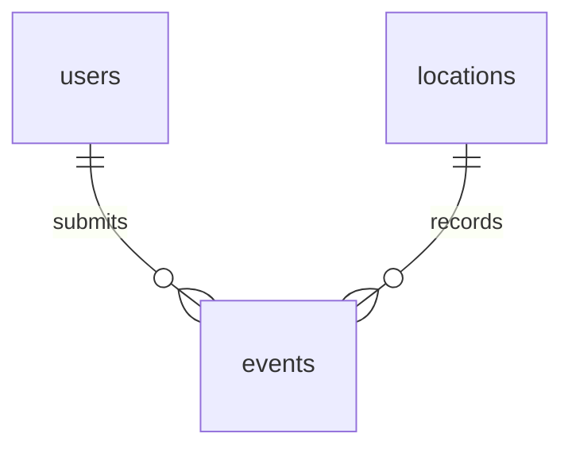

# SmartSlope Version 1.0 — Application reference

## Purpose and scope

Provide a single-area academic interface for viewing weather-based rainfall
screening and collecting resident observations in Barangay Irisan. Resident
reports provide context, not automatic hazard confirmation. Administrators
manage records and review submissions. No measured accuracy, adoption, revenue
or sensor deployment is claimed.

## Roles and data flow

| Action | Resident | Admin |
| --- | --- | --- |
| Map, saved readings/details, weather refresh | Yes | Yes |
| Reading CSV download | Yes | Yes |
| Submit report, see own history | Yes | No resident form |
| See all reports/contact details; review/delete | No | Yes |
| Location create/edit/activate/deactivate | No | Yes |
| Edit saved reading values/risk, delete readings | No | Yes |
| Reading/location CSV import, location export | No | Yes |
| Bulk data actions | No | Yes |

A map selection performs address lookup, then (on dashboards) posts a weather
request. PHP validates coordinates and provider data, calculates rainfall totals,
saves the event and returns JSON. The browser reloads saved data. Normal page
loads do not fetch/save weather. Failed providers preserve existing readings.

The report form selects an active location or creates one for valid new
coordinates on successful submission. A report event stores the point/address
snapshot in `provider_payload`. Reports do not affect calculated rainfall risk.

## Routes

| File | Purpose |
| --- | --- |
| `index.php` | Register/login; server assigns new registrations role user |
| `dashboard.php` | Redirect to role-specific dashboard |
| `users/admin/admin.php`, `users/user/user.php` | Role-specific dashboard entry points |
| `users/admin/admin_panel.php` | Location management |
| `users/user/submit_report.php` | Resident report form and own history |
| `users/admin/reports.php` | Report filters, View map, review and deletion |
| `readings.php` | Saved history, detail panel, admin deletion and CSV controls |
| `users/admin/edit_reading.php` | Admin values and saved-risk editing |
| `users/admin/bulk.php` | Admin POST-only selected-row actions |
| `csv.php?kind=readings` or `kind=locations` | GET download / admin POST multipart `csv_file` import |
| `methodology.php` | Rainfall rules, data sources and limitations |
| `logout.php` | POST logout |

## JSON endpoints

`api/readings.php`: authentication required. GET `location_id` loads saved data;
POST `location_id` or `lat` + `lng` refreshes weather. Successful JSON contains
`location_id`, `saved_id` (null for GET), `reading`, and `assessment`. Assessment
contains status, category, expires_at, calculated_category and adjusted.
Errors use `error`: 400 invalid/inactive point, 401 unauthenticated, 405 method,
502 provider/runtime failure, 503 database failure or 500 unexpected processing.

`api/address.php`: authenticated GET `lat` + `lng`; returns `name` and `address`
when available. A failed detailed lookup can return HTTP 200 with empty address
and an explanatory error. This is a usable coordinate selection, not a crash.
Addresses are cached in the session (maximum 100 entries) and uncached lookups
are limited to one per second per session. It is not a global provider throttle.

## Rainfall screening

| Category | 1h threshold | 24h threshold | 72h threshold |
| --- | --- | --- | --- |
| High | 50 mm | 100 mm | 150 mm |
| Medium | 25 mm | 50 mm | 100 mm |
| Normal | 10 mm | 25 mm | 50 mm |
| Low | Below every threshold | Below every threshold | Below every threshold |

Highest qualifying category wins if any window reaches its threshold. Values
must be finite, nonnegative and ordered 1h ≤ 24h ≤ 72h. These are prototype
software rules, not published/calibrated Irisan alert thresholds. The rule ID is
`prototype-1`; this does not indicate a prior application release.

Hourly precipitation comes from Open-Meteo. Only completed hourly samples are
summed, ending at the observation hour in UTC. Complete 72-hour history is
required. Current assessment needs compatible metadata and a window younger
than three hours; missing/legacy/imported metadata is incomplete, not fresh.
Admin-selected risk is kept distinct from calculated rainfall category.
Map colors represent the latest unarchived **saved** reading, which can be old.

## Database relationships

Exactly three tables: `users`, `locations`, `events`. One user can have many
report events; one location can have many reading/report events. `type` separates
reading and report rows. Most type-specific columns are nullable because they
share one events table. This keeps the schema small but requires every action
to constrain event type. It is not a separate sensor or alerts database.

`events.user_id` is optional and deletes set it NULL. Deleting a location at the
SQL level cascades to its events; application bulk delete prevents deleting
linked locations. Deactivation changes visibility without deleting history.
`reviewed_by` is an ID value but the schema does not declare a foreign key for it.

The following dictionary reflects database/schema.sql. Fields retained in the
schema but unused by the UI are identified; do not remove them during setup.

### users

| Field | SQL definition | Meaning |
| --- | --- | --- |
| `id` | `INT UNSIGNED NOT NULL AUTO_INCREMENT` | Auto-increment primary key. |
| `full_name` | `VARCHAR(100) NOT NULL` | Account display name. |
| `username` | `VARCHAR(50) NOT NULL` | Unique login name. |
| `email` | `VARCHAR(254) NOT NULL` | Unique account email. |
| `phone` | `VARCHAR(20) NOT NULL` | Unique account contact number. |
| `password` | `VARCHAR(255) NOT NULL` | Hash generated by password_hash(); never plaintext. |
| `role` | `ENUM('admin', 'user') NOT NULL DEFAULT 'user'` | admin or user; registration assigns user. |
| `created_at` | `TIMESTAMP NOT NULL DEFAULT CURRENT_TIMESTAMP` | Creation timestamp; connections use UTC. |

### locations

| Field | SQL definition | Meaning |
| --- | --- | --- |
| `id` | `INT UNSIGNED NOT NULL AUTO_INCREMENT` | Auto-increment primary key. |
| `name` | `VARCHAR(150) NOT NULL` | Saved location name. |
| `purok` | `VARCHAR(100)` | Optional house number / extra location information (UI label). |
| `landmark` | `VARCHAR(255)` | Saved mapped address / landmark. |
| `lat` | `DECIMAL(9,6)` | Latitude; application restricts selected points to Irisan. |
| `lng` | `DECIMAL(9,6)` | Longitude; unique pair with latitude. |
| `susceptibility` | `ENUM('very_high','high','moderate','low','debris_flow','unknown') DEFAULT 'unknown'` | Stored metadata; not used in Version 1.0 rainfall calculation. |
| `active` | `TINYINT(1) DEFAULT 1` | 1 active; 0 hidden from selection maps/dropdowns. |
| `created_at` | `TIMESTAMP NOT NULL DEFAULT CURRENT_TIMESTAMP` | Creation timestamp; connections use UTC. |

### events

| Field | SQL definition | Meaning |
| --- | --- | --- |
| `id` | `INT UNSIGNED NOT NULL AUTO_INCREMENT` | Auto-increment primary key. |
| `location_id` | `INT UNSIGNED NOT NULL` | Required FK to locations.id; SQL ON DELETE CASCADE. |
| `user_id` | `INT UNSIGNED` | Optional FK to users.id; ON DELETE SET NULL. |
| `type` | `ENUM('reading','report') NOT NULL` | reading or report; actions must constrain this field. |
| `rainfall_1h` | `DECIMAL(7,2)` | Precipitation total in mm over one completed hour. |
| `rainfall_24h` | `DECIMAL(7,2)` | Precipitation total in mm over 24 completed hours. |
| `rainfall_72h` | `DECIMAL(7,2)` | Precipitation total in mm over 72 completed hours. |
| `rainfall_forecast_24h` | `DECIMAL(7,2)` | Reserved; not used by this release. |
| `precipitation_probability_24h` | `TINYINT UNSIGNED` | Reserved; not used by this release. |
| `soil_moisture_9_27cm` | `DECIMAL(6,4)` | Reserved; not used by this release. |
| `soil_moisture_27_81cm` | `DECIMAL(6,4)` | Reserved; not used by this release. |
| `risk_level` | `ENUM('low','normal','medium','high') DEFAULT 'low'` | Saved low/normal/medium/high category; may be admin-selected. |
| `temperature` | `DECIMAL(5,2)` | Temperature in degrees Celsius. |
| `humidity` | `DECIMAL(5,2)` | Relative humidity in percent. |
| `wind_speed` | `DECIMAL(6,2)` | Wind speed in km/h. |
| `weather_code` | `INT` | Provider WMO weather code. |
| `observed_at` | `DATETIME` | Weather observation timestamp, UTC. |
| `source` | `ENUM('openmeteo','manual') DEFAULT 'openmeteo'` | openmeteo or manual (including CSV). |
| `message` | `TEXT` | Resident observation text. |
| `contact_phone` | `VARCHAR(20)` | Required by report form. |
| `contact_email` | `VARCHAR(254)` | Required by report form. |
| `house_landmark` | `VARCHAR(255)` | Optional report-specific directions. |
| `status` | `ENUM('pending','reviewed','resolved') DEFAULT 'pending'` | Report workflow: pending/reviewed/resolved. |
| `rule_version` | `VARCHAR(40) NULL` | Rainfall rule identifier; nullable for legacy/CSV records. |
| `rainfall_window_end` | `DATETIME NULL` | Completed-hour end time, UTC. |
| `provider_payload` | `LONGTEXT NULL` | Reading: provider JSON; report: report_location point/address snapshot. |
| `adjustment_log` | `LONGTEXT NULL` | Admin edit/import metadata JSON. |
| `report_type` | `VARCHAR(30) NULL` | cracks/landslide/drainage/other, validated in PHP. |
| `occurred_at` | `DATETIME NULL` | Report observation time stored UTC; form uses Manila time. |
| `reviewed_by` | `INT UNSIGNED NULL` | Reviewing admin ID; no declared FK. |
| `reviewed_at` | `DATETIME NULL` | Review timestamp, UTC. |
| `created_at` | `TIMESTAMP NOT NULL DEFAULT CURRENT_TIMESTAMP` | Creation timestamp; connections use UTC. |
| `archived` | `TINYINT(1) DEFAULT 0` | Reading list excludes 1; no archive UI. |
| `stale` | `TINYINT(1) DEFAULT 0` | Retained legacy flag; assessment freshness is computed from timestamps. |

### Keys and constraints

users: unique username/email/phone. locations: unique latitude/longitude pair.
events: indexes on location_id, user_id, type, risk_level and archived, plus primary
key. Imported duplicates use location and observed_at checks in application code;
there is no database unique constraint on that event pair. Concurrent imports
are not guaranteed duplicate-free. Admin bulk actions accept up to 500 IDs.

## External dependencies and operations

Open-Meteo weather endpoint and Photon reverse lookup require internet and PHP
cURL. Providers may fail, limit requests or change. Errors are surfaced without
replacing saved weather. Address accuracy depends on mapped coverage. Local
Bootstrap and Leaflet are served without CDNs. Preserve bundled licenses and
OpenStreetMap attribution; tile image redistribution provenance needs confirmation
before public hosting. The repository's tile README records that limitation.

Use database exports for backups, not CSV alone. No password-reset/change UI,
email/SMS delivery, scheduled weather polling, realtime cross-tab push updates,
payments, sensor ingestion, location susceptibility calibration or production
monitoring is implemented. Sessions do not regenerate IDs and no CSRF token
scheme/login throttling is provided; public deployment requires hardening.
